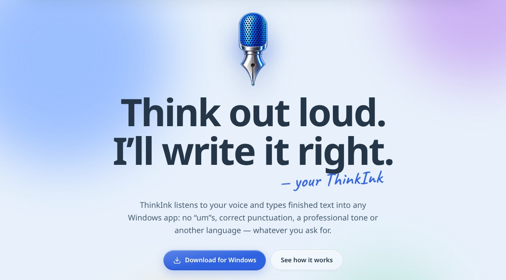
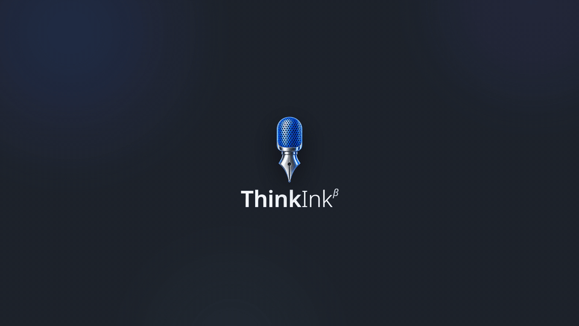
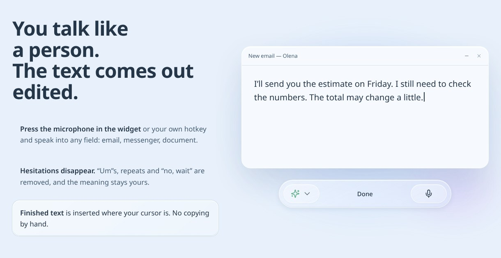
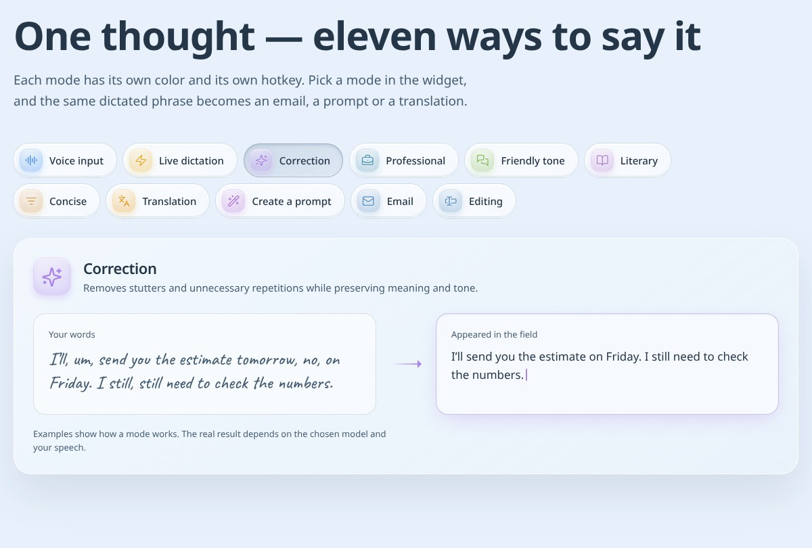
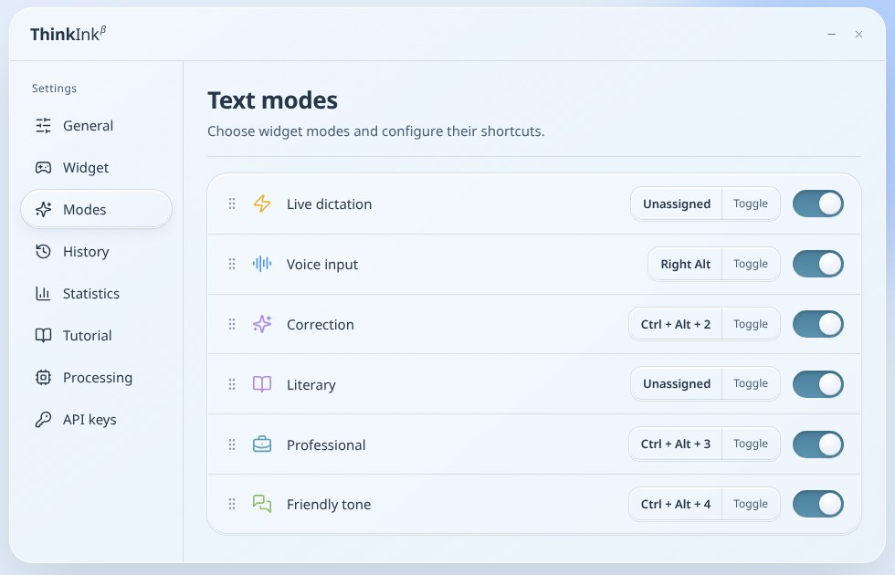

  

<b>English</b> · <a href="README.uk.md">Українська</a>

# ThinkInk

**Think out loud. I’ll write it right.** — your ThinkInk

  

ThinkInk listens to your voice and types finished text into any Windows app: no “um”s, correct punctuation, a professional tone or another language — whatever you ask for.

**[Download for Windows](https://github.com/AndriyGusak/ThinkInk/releases/latest)** · [Website](https://thinkink.com.ua/en/) · [FAQ](https://thinkink.com.ua/en/#faq)

> The app interface is available in English, Ukrainian, German, Polish, Spanish, French and Portuguese.

## How it works

- Press the microphone in the widget or your own hotkey and speak into any field: email, messenger, document.
- “Um”s, repeats and “no, wait” are removed, and the meaning stays yours.
- The finished text is inserted where your cursor is. No copying by hand.

## 11 modes

Correction, Professional, Friendly tone, Literary, Concise, Translation, Create a prompt, Email and more. Each mode can have its own hotkey.

**Edit by voice:** select text and say what to do with it: “make it formal”, “shorten it but keep all the dates”. The result goes straight to the clipboard, so you can paste it anywhere.

## What you get

- **Free app.** Text processing runs through your own subscription or API key — you pay only the service itself, if it is paid.
- **Your choice of AI.** For text: OpenAI, Claude or Gemini, via your account (ChatGPT, Claude Code) or an API key. For voice: Whisper on your computer, OpenAI or Gemini.
- **Offline speech recognition.** Whisper runs on your computer, with or without an NVIDIA graphics card.
- **Translation while you dictate.** Speak one language, get text in another.
- **Your voice is not stored.** Audio lives only in memory, history stays in your Windows profile, API keys are encrypted.
- **History and statistics.** Search, restore deleted items, see how many words you dictated and what processing cost.

## Install

1. Open the [latest release](https://github.com/AndriyGusak/ThinkInk/releases/latest).
2. Download `ThinkInk-…-Setup.exe` and run it.
3. The app finds updates by itself.

This is a beta (β) for Windows x64 only. One recording is up to 15 minutes.

## License

The app is free; the source code is not published. Terms: [LICENSE.md](LICENSE.md).
