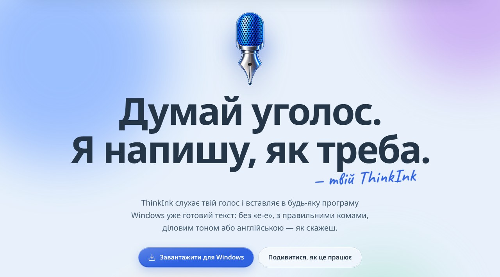
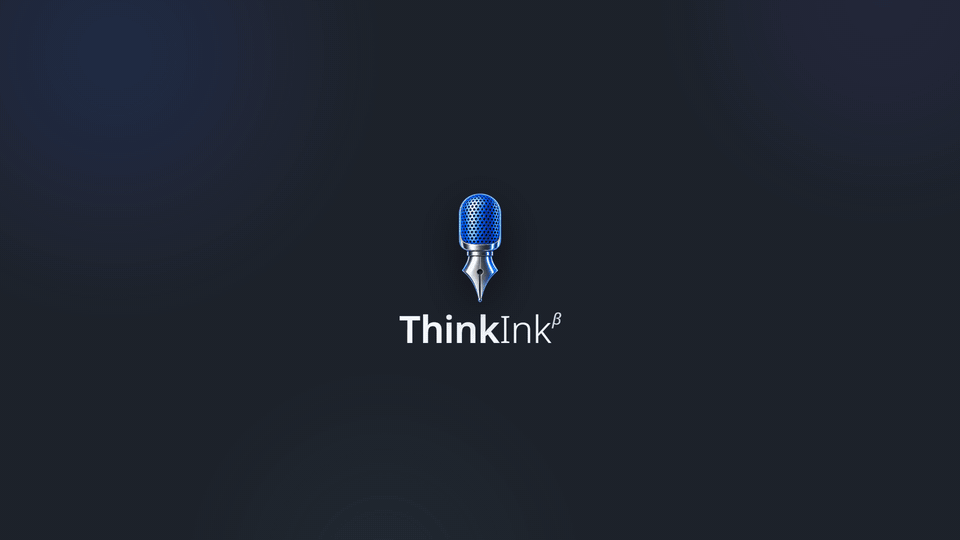
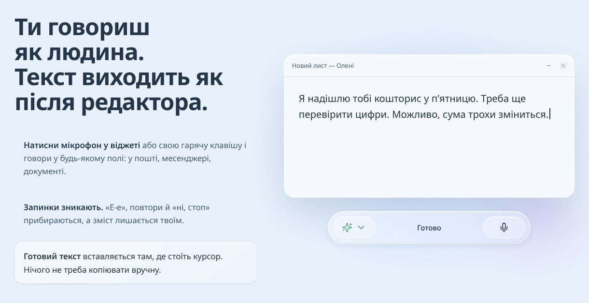
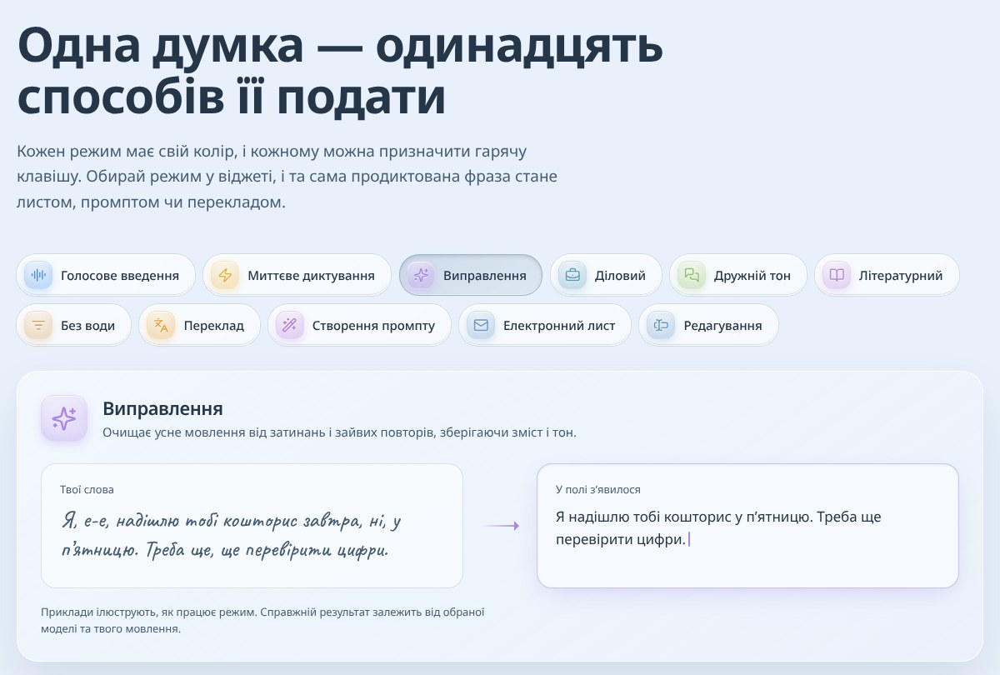
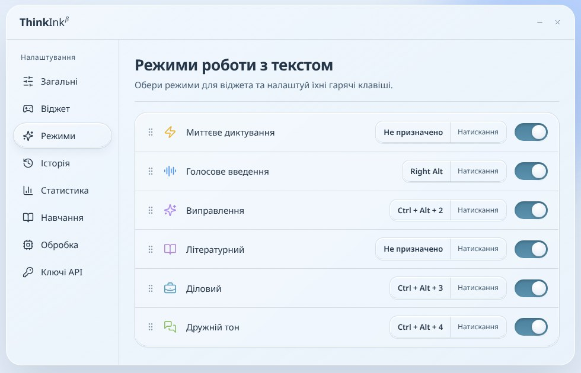

  

<a href="README.md">English</a> · <b>Українська</b>

# ThinkInk

**Думай уголос. Я напишу, як треба.** — твій ThinkInk

  

ThinkInk слухає твій голос і вставляє в будь-яку програму Windows уже готовий текст: без «е-е», з правильними комами, діловим тоном або англійською — як скажеш.

**[Завантажити для Windows](https://github.com/AndriyGusak/ThinkInk/releases/latest)** · **[Сайт thinkink.com.ua](https://thinkink.com.ua)** · [Часті питання](https://thinkink.com.ua/#faq)

## Як це працює

- Натисни мікрофон у віджеті або свою гарячу клавішу і говори в будь-якому полі: у пошті, месенджері, документі.
- «Е-е», повтори й «ні, стоп» прибираються, а зміст лишається твоїм.
- Готовий текст вставляється там, де стоїть курсор. Нічого не треба копіювати вручну.

## 11 режимів

Виправлення, діловий і дружній тон, лист, промпт, «без води», переклад та інші. Кожному режиму можна призначити гарячу клавішу.

**Редагування голосом:** виділи текст і скажи, що з ним зробити: «формалізуй», «скороти, але збережи дати». Результат одразу в буфері обміну.

## Що ти отримуєш

- **Безкоштовна програма.** Обробка тексту йде через твою підписку або твій ключ API — платиш лише самому сервісу, якщо він платний.
- **ШІ на твій вибір.** Для тексту — OpenAI, Claude або Gemini: через акаунт (ChatGPT, Claude Code) або через ключ API. Для голосу — Whisper на комп'ютері, OpenAI або Gemini.
- **Розпізнавання без інтернету.** Whisper працює на твоєму комп'ютері, з відеокартою NVIDIA або без неї.
- **Переклад під час диктування.** Говориш однією мовою — у полі з'являється текст іншою.
- **Голос не зберігається.** Аудіо живе лише в пам'яті, історія — у твоєму профілі Windows, ключі API зашифровані.
- **Українською з першого дня.** Інтерфейс є також англійською, німецькою, польською, іспанською, французькою й португальською.

## Встановлення

1. Відкрий [останній випуск](https://github.com/AndriyGusak/ThinkInk/releases/latest).
2. Завантаж файл `ThinkInk-…-Setup.exe` і запусти його.
3. Оновлення програма знаходить сама.

Це тестова версія β — лише для Windows x64. Один запис — до 15 хвилин.

## Ліцензія

Програма безкоштовна, код не публікується. Умови — у [LICENSE.md](LICENSE.md).
